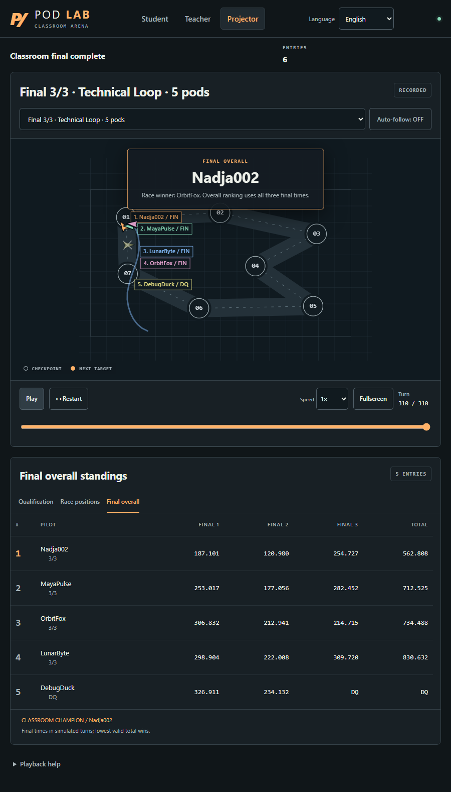

# Pod Racing Classroom

**Python bots. Fair qualification. A three-track classroom final.**

Made for **Codeweek 2026 in Wiesbaden**. A self-hosted teaching game with English/German student, teacher and projector views, alias-based submissions, private practice and animated race replays. Students need a browser; the teacher runs Docker.

This is an independent classroom game inspired by CodinGame, **not its official referee or an affiliated product**. Each student controls one pod; the five-pod final is not Gold-league two-pod play.

[Deutsch](README.de.md) · [AI-assisted setup](docs/agent-setup.md) · [Security](SECURITY.md) · [Contributing](CONTRIBUTING.md) · [MIT license](LICENSE)



[Watch the real replay demo (WebM)](docs/media/demo.webm) · [Capture provenance and synthetic-data scope](docs/media/README.md). These captures show the real application, not mockups; they do not establish release publication or platform acceptance.

## Quickstart: choose your installation

**Both routes require Docker with Compose**, started before launching: Docker Desktop in **Linux-container mode** on Windows/macOS, or Docker Engine with the Compose plugin on Linux. No host Python, Git, Node.js, npm or uv is required when using an archive. First installation needs internet access; once images are available, the classroom runs locally without a cloud service or CodinGame account.

### Prebuilt release ZIP — pending publication

The intended first release is **v1.0.0**, with the asset **`Pod-Racing-Classroom-v1.0.0.zip`** on [GitHub Releases](https://github.com/igathedub/pod-racing-classroom/releases). **Do not assume that this asset or its images exist until that release is published.** GitHub's automatic “Source code” archive is not the prebuilt ZIP. Use the source-build route below in the meantime.

Once published:

1. Download that ZIP and extract it into a new, dedicated classroom folder. Keep that folder for subsequent starts and updates.
2. Windows: double-click **`Start.cmd`**. macOS: use **`Start.command`**, or **`sh Start.sh`** in Terminal if blocked. Linux: **`sh Start.sh`**. These launchers pull the pinned app and bot images; they do not build source locally.
3. Wait for the classroom to be healthy. Open **http://localhost:8765/teacher** and privately read the **Teacher admin token** in **`teacher-private.log`** in that folder. Start saves it with owner-only permissions instead of printing it to the console. Do not project, paste into chat or publish this file/token.
4. Open **http://localhost:8765/projector** for projection; **http://localhost:8765/** is the student page on this computer.

The release ZIP's `compose.yaml` pins `ghcr.io/igathedub/pod-racing-classroom-app@sha256:…` and `ghcr.io/igathedub/pod-racing-classroom-bot@sha256:…` to immutable multi-architecture digests resolved from the published **`v1.0.0`** tags, not `:1.0.0` or `latest`. The ellipses here are notation, not usable image references. Publication and anonymous image pulls are **not verified by these instructions**. A fresh installation uses the one-line **checkpoint-only** protocol. `Stop.cmd` / `Stop.command` / `sh Stop.sh` stop the saved project without deleting its data. Closing the launcher window does not stop detached containers.

The ZIP launchers save a unique project name in **`.classroom-project`**; keep it for every restart/update. They ignore ambient `.env` files and the ZIP fixes **`127.0.0.1:8765`** in `compose.yaml`. The source-only `.env` settings and plain Compose commands below are not ZIP configuration instructions. If port 8765 is occupied, do not stop an unrelated service; resolve the conflict or use an explicitly configured source installation.

### Build from the public source — available now

Download and extract the public repository's source archive, or clone it if you already have Git. Until v1.0.0 is published, the tested application baseline for this guide is commit **`804ac8804dff8b29d0e1ccc4364bd29d0b46fdf2`**; it is not a released binary.

For **source installations only**, in a **new installation folder**, create `.env` beside the root `compose.yaml`:

```dotenv
COMPOSE_PROJECT_NAME=pod-classroom-my-workshop
POD_BOT_IMAGE=pod-classroom-bot:my-workshop
POD_INPUT_PROTOCOL=checkpoint-only
POD_BIND=127.0.0.1
POD_PORT=8765
```

Choose a unique project name and local `POD_BOT_IMAGE` tag per independent source installation, so one build cannot replace another classroom's sandbox image. Do **not** apply this fresh-install example over an existing deployment's configuration. Source Compose defaults to the older `legacy` protocol unless explicitly configured; the setting above selects the new one-line starter without modifying saved bots.

- **Windows:** double-click **`Docker-start.cmd`**.
- **macOS/Linux:** run **`sh Docker-start.sh`**.

These existing source launchers build the app and sandbox images, wait for health and display local logs. Then use the same teacher/projector URLs above. Equivalent **source-only** commands from that folder:

```sh
docker compose up --build -d --wait --wait-timeout 180
docker compose ps
docker compose logs classroom
```

Each fresh data installation generates its **own random teacher key** and persists it. There is no shared/default password. In a **source installation**, the key appears in local app logs; recover it with `docker compose logs classroom`. In the **ZIP**, Start saves those logs privately to `teacher-private.log`. Never delete data to recover a key or share unredacted logs.

## Run a lesson

1. On a **separate empty demo installation**, add the six demo bots, run qualification and the three-track final before the workshop. Never reset a real classroom as a test.
2. At `/teacher`, open the coding session. The submission window defaults to **120 minutes** and accepts **1–1440 whole minutes**. While submissions are open, setting remaining time counts from that click; it is separate from an invitation's expiry.
3. Students choose an alias and paste/upload Python. They can update their entry before the deadline using the same browser's private claim key. Save source separately; a claim key is not the teacher key.
4. Close submissions, then run qualification. Source versions are frozen. Up to **100 submissions** are supported; this does not mean 100 simultaneously running pods.
5. Run the final after qualification: the best eligible **up to five** bots compete, with at least two required. Project the replay view, not teacher credentials. **Final overall** is separate from the current race's positions.

Teacher moderation can remove an entry, including **all replays containing that bot**, even shared final replays. It requires confirmation and is blocked while a race/job is running. It is deletion, not a permanent participant ban.

## Rules and Python interface

Fresh installations use **one input line per turn**, with no opponent-coordinate line:

```text
x y checkpoint_x checkpoint_y distance relative_angle
```

Output one action and flush it:

```text
target_x target_y thrust
```

Read the website's starter and rules for the **active installation**. An existing `legacy` installation sends a second opponent line; changing protocols breaks bots that still read it. The checkpoint-only Nadja starter must **not** read an enemy line.

- Python standard library only. Keep persistent state outside the loop. Use `print(..., flush=True)`; debugging goes to `sys.stderr`.
- Numeric thrust is 0–100 (out-of-range integers are clamped). `BOOST` works once per race; later uses behave as thrust 100. `SHIELD` suppresses thrust on its activation turn and the next two turns; it has no defensive effect without collisions.
- Practice, qualification and final all run without collisions. Pods cannot push or block each other.
- Qualification uses the same three deterministic courses for every bot: Wide Circuit, Five Corners and Switchback. A disqualified bot cannot enter the final.
- The final uses **Hairpin Run, Diamond Loop and Technical Loop**. The lowest sum of the **three unrounded final finish times** wins; qualification times do not count. These are fractional **simulated turns, not real seconds**. Display rounding does not affect ranking.
- A champion must finish all three final tracks without disqualification. Otherwise the result is DNF/DQ; if nobody has a valid total, there is no champion. Exact total ties use case-folded alias, then UUID.
- Teacher views can show the aggregate immediately. Student/projector views reveal it after the third current final replay finishes, once the series/job is complete. This presentation timing is not an API secrecy boundary.

More: [three-track scoring](docs/three-track-final.md) · [submission-window controls](docs/configurable-submission-time.md).

## Local first; trusted LAN only by explicit choice

Default binding is **`127.0.0.1:8765`**, accessible only on the host. Nothing in this guide automatically opens a firewall, creates a tunnel or changes an existing live deployment.

For a trusted classroom LAN **using a source installation only**, agree the change with school IT, then explicitly set `POD_BIND=0.0.0.0` in **this installation's** `.env` and recreate its service with `docker compose up -d`. Share the host's private LAN IP, not a Docker/VPN address. Limit firewall access to the private local subnet and test from a second device; guest Wi-Fi may block peers. Linux Docker port publishing may bypass some host-firewall rules: verify actual exposure. Restore `POD_BIND=127.0.0.1` and recreate to return to local-only use. An occupied port can be changed with `POD_PORT`, updating all URLs accordingly.

Optional classroom invitations admit up to **100 participant sessions**, including projector browsers. They use expiring shared codes and cookies, not individual identity or abuse-proof admission. HTTPS is required for default Secure cookies. Invitations and rate limits **do not make anonymous public code execution safe**. See [Security](SECURITY.md).

## Stop, restart, update — preserve your classroom

**ZIP:** stop with `Stop.cmd` / `Stop.command` / `sh Stop.sh`, then resume with `Start.cmd` / `Start.command` / `sh Start.sh` in the **same folder**, retaining `.classroom-project`. Do not use plain `docker compose stop/start` for the ZIP: it omits the saved project, defaults file and socket setup.

**Source only:** run commands from the same installation folder with the **same Compose project name and configuration**:

```sh
docker compose stop
docker compose start
docker compose ps
```

Sessions, source, frozen entries, replays and the teacher key live in the project-scoped `classroom-data` volume, mounted at `/data`. For source installations, `docker compose down` retains that volume, but restart after `down` requires `docker compose up -d`. **Never use `down --volumes`, volume prune or reset as an update/recovery step.** Changing a source project name/folder or losing the ZIP's `.classroom-project` can select a different volume and make existing data appear missing.

Finish active jobs, stop and privately back up the complete data volume and installation state before updating. **ZIP:** review release notes/checksums, then extract the newer verified release **over the same installation folder**, preserving `.classroom-project`, the data volume and teacher key; use its Start launcher to pull/start. Do not extract into a new folder or replace the saved project file. **Source:** retain `.env`, project name, unique bot image tag, data volume and teacher key; after reviewing changes use `docker compose up --build -d`. Do not turn a running classroom into a fresh installation or silently change its protocol. Interrupted jobs are marked failed, not resumed. A copied source/ZIP folder alone is **not a data backup**. Backups include student source and private credentials.

## Security boundary

Untrusted bots run **only in restricted Docker containers**: no network, Docker socket or host mounts; non-root execution, read-only filesystem, dropped capabilities and resource/output limits. Missing Docker/sandbox fails closed; no host-execution fallback.

**The trusted app mounts the Docker socket: this is host-admin-equivalent access.** A read-only socket mount is not a boundary. Docker isolation is not a guarantee against kernel/runtime vulnerabilities. This is a local/trusted-LAN classroom tool, **not a turnkey anonymous internet service**. Public deployment requires independent isolation, access, HTTPS, origin and abuse reviews. Keep Docker patched and use a dedicated disposable VM for genuinely hostile code. See [SECURITY.md](SECURITY.md) before deployment.

For source installations, rootless Linux needs the real socket in `POD_DOCKER_SOCKET` and a host Compose client targeting that same daemon. Remote Docker contexts are not the standard supported setup; rootless resource limits depend on cgroup support. Do not guess a socket path or reuse a Windows `npipe://` endpoint inside Linux containers.

## Performance and platform evidence

A reported full-workflow benchmark on a **16-logical-CPU Windows desktop** used 100 identical Nadja sources and **100 logical HTTP clients**, not 100 rendered browsers:

| Measurement | Observed result |
|---|---|
| 100 submissions | 0.645 s total; p95 571 ms |
| 300 qualification races | 858.436 s |
| Three final races | 36.192 s |
| Archives | 303; no DQ/DNF |
| Poll requests | 99,873; all HTTP 200, no timeouts |
| Final state response latency | p95 3.327 s; max 4.481 s |

Polling still missed **511 state / 1,405 replay ticks** during the final and **2,100 qualification replay ticks**. Successful HTTP responses are **not** evidence of smooth 100-browser playback, fixed classroom duration or public-hosting capacity. Different bots and hardware change runtime. Older single-final measurements in historical notes are not the current three-track workload.

| Platform | Scope of evidence / recommendation |
|---|---|
| Windows + Docker Desktop, Linux x86-64 containers | Real Docker classroom workflows exercised; benchmark above on a Windows desktop. |
| macOS + Docker Desktop | Intended setup; no fresh hardware installation verified for this release. Manually run the full demo on the target Mac before teaching. |
| Native Linux / ARM64 | Build/platform support is not hardware acceptance. Check actual published CI/image results and manually preflight the target machine; do not infer native execution from multi-architecture manifests. |

## Troubleshooting and community

- **Docker unavailable/unhealthy:** start Docker and select Linux containers. ZIP: retry its Start launcher and inspect errors locally. Source: inspect `docker compose ps` and local `docker compose logs classroom`; check daemon/socket alignment.
- **Port conflict:** ZIP port 8765 is fixed; source installations can choose another `POD_PORT`. Do not stop an unrelated service.
- **Data looks empty:** check the original folder and ZIP `.classroom-project`, or source `.env` and project name. Do not reset or create new data over it.
- **Lost teacher key:** ZIP: run Start and privately read `teacher-private.log`; source: inspect local classroom logs. Do not share unredacted logs or delete the volume.

For setup automation use the [safe agent prompt](docs/agent-setup.md). Report reproducible non-security problems through [GitHub Issues](https://github.com/igathedub/pod-racing-classroom/issues); follow [SECURITY.md](SECURITY.md) for vulnerabilities. [Contributions](CONTRIBUTING.md) are welcome. Original project code is [MIT licensed](LICENSE); dependencies retain their own licenses.
